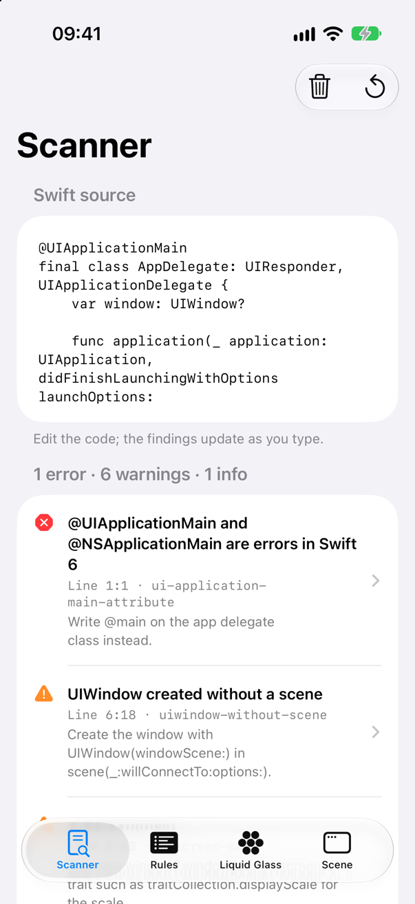
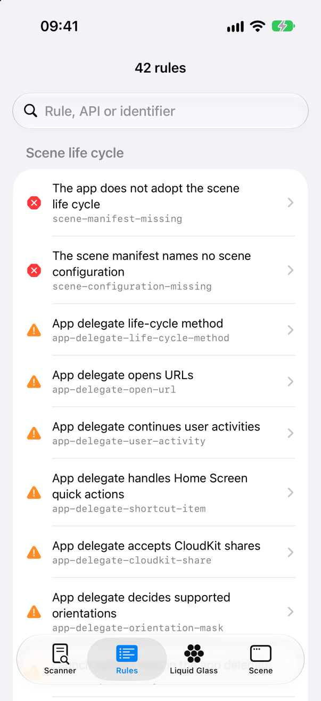
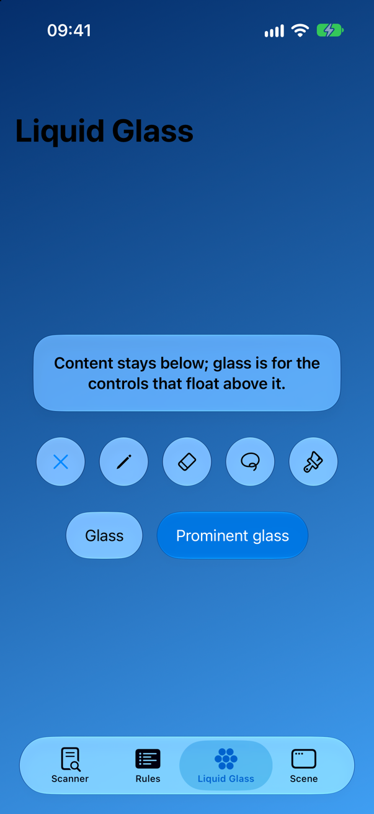
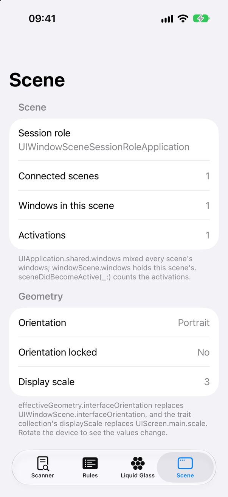

<!-- i18n-source: README.md@160fc1ab707277cda7e31fd2d880426e457f1746 status=reviewed -->
<!-- brand:start -->

<p align="center"><picture><source media="(prefers-color-scheme: dark)" srcset="https://raw.githubusercontent.com/muhittincamdali/iOS26-Migration-Guide/main/.github/brand/banner-dark.svg"><source media="(prefers-color-scheme: light)" srcset="https://raw.githubusercontent.com/muhittincamdali/iOS26-Migration-Guide/main/.github/brand/banner-light.svg"></picture></p>

<!-- lang-selector:start -->
<p align="center"><a href="README.md">English</a> · <a href="README.tr.md">Türkçe</a> · <a href="README.zh-CN.md">简体中文</a> · <a href="README.ja.md">日本語</a> · <a href="README.ko.md">한국어</a> · <a href="README.es.md">Español</a> · <a href="README.de.md">Deutsch</a> · <a href="README.fr.md">Français</a> · <a href="README.pt-BR.md">Português (Brasil)</a> · <a href="README.ru.md">Русский</a></p>
<!-- lang-selector:end -->

<p align="center">
<a href="https://github.com/muhittincamdali/iOS26-Migration-Guide/actions/workflows/ci.yml"></a>
<a href="https://github.com/muhittincamdali/iOS26-Migration-Guide/releases"><picture><source media="(prefers-color-scheme: dark)" srcset="https://raw.githubusercontent.com/muhittincamdali/iOS26-Migration-Guide/main/.github/brand/badge-version-dark.svg"><source media="(prefers-color-scheme: light)" srcset="https://raw.githubusercontent.com/muhittincamdali/iOS26-Migration-Guide/main/.github/brand/badge-version-light.svg"></picture></a>
<a href="https://github.com/muhittincamdali/iOS26-Migration-Guide/blob/main/Package.swift"><picture><source media="(prefers-color-scheme: dark)" srcset="https://raw.githubusercontent.com/muhittincamdali/iOS26-Migration-Guide/main/.github/brand/badge-platforms-dark.svg"><source media="(prefers-color-scheme: light)" srcset="https://raw.githubusercontent.com/muhittincamdali/iOS26-Migration-Guide/main/.github/brand/badge-platforms-light.svg"></picture></a>
<a href="https://github.com/muhittincamdali/iOS26-Migration-Guide/blob/main/Package.swift"><picture><source media="(prefers-color-scheme: dark)" srcset="https://raw.githubusercontent.com/muhittincamdali/iOS26-Migration-Guide/main/.github/brand/badge-language-dark.svg"><source media="(prefers-color-scheme: light)" srcset="https://raw.githubusercontent.com/muhittincamdali/iOS26-Migration-Guide/main/.github/brand/badge-language-light.svg"></picture></a>
<a href="https://github.com/muhittincamdali/iOS26-Migration-Guide/blob/main/LICENSE"><picture><source media="(prefers-color-scheme: dark)" srcset="https://raw.githubusercontent.com/muhittincamdali/iOS26-Migration-Guide/main/.github/brand/badge-license-dark.svg"><source media="(prefers-color-scheme: light)" srcset="https://raw.githubusercontent.com/muhittincamdali/iOS26-Migration-Guide/main/.github/brand/badge-license-light.svg"></picture></a>
</p>

<p align="center">
<a href="#빠른-시작"><picture><source media="(prefers-color-scheme: dark)" srcset="https://raw.githubusercontent.com/muhittincamdali/iOS26-Migration-Guide/main/.github/brand/button-start-ko-dark.svg"><source media="(prefers-color-scheme: light)" srcset="https://raw.githubusercontent.com/muhittincamdali/iOS26-Migration-Guide/main/.github/brand/button-start-ko-light.svg"></picture></a>
<a href="https://muhittincamdali.github.io/iOS26-Migration-Guide/documentation/migrationscanner/"><picture><source media="(prefers-color-scheme: dark)" srcset="https://raw.githubusercontent.com/muhittincamdali/iOS26-Migration-Guide/main/.github/brand/button-docs-ko-dark.svg"><source media="(prefers-color-scheme: light)" srcset="https://raw.githubusercontent.com/muhittincamdali/iOS26-Migration-Guide/main/.github/brand/button-docs-ko-light.svg"></picture></a>
<a href="https://github.com/muhittincamdali/iOS26-Migration-Guide/tree/main/Examples"><picture><source media="(prefers-color-scheme: dark)" srcset="https://raw.githubusercontent.com/muhittincamdali/iOS26-Migration-Guide/main/.github/brand/button-examples-ko-dark.svg"><source media="(prefers-color-scheme: light)" srcset="https://raw.githubusercontent.com/muhittincamdali/iOS26-Migration-Guide/main/.github/brand/button-examples-ko-light.svg"></picture></a>
</p>

> 이 문서는 영어 README의 번역본입니다. 내용이 다를 경우 영어 버전이 최신입니다.

<!-- brand:end -->

iOS 앱을 iOS 26 및 iOS 27 SDK로 옮기기 위한 명령줄 도구, Swift 라이브러리, 그리고 가이드 모음입니다. `migration-scan`은 Swift 소스, Info.plist 파일, Xcode 빌드 설정을 읽고 해당 SDK가 지원 중단했거나 무시하거나 거부하는 항목을 나열합니다. 각 항목에는 대신 무엇을 써야 하는지와 Apple 문서 링크가 함께 표시됩니다. Xcode가 알려 주기 전에 목록을 미리 받아 보고 싶은 앱 개발자를 위한 도구이며, Xcode가 전혀 알려 주지 않는 변경 사항도 다룹니다. 예를 들어 scene manifest가 없는 UIKit 앱은 iOS 27 SDK로 빌드하면 실행되지 않는데, 컴파일러는 이에 대해 아무 말도 하지 않습니다.

## 주요 기능

- **앱이 실행되지 않게 만드는 문제를 찾습니다** — scene manifest가 없거나, manifest에 scene 구성이 지정되지 않은 UIKit app delegate는 Apple의 TN3187에 따라 오류로 보고됩니다.
- **컴파일러가 경고하지 않는 문제를 찾습니다** — 앱이 scene을 사용하면 UIKit이 더 이상 호출하지 않는 app delegate 메서드, iOS 27이 무시하는 `UIDesignRequiresCompatibility`, 앞으로 나올 릴리스에서만 지원 중단되는 SwiftUI API를 찾습니다.
- **모든 규칙을 SDK와 대조해 확인했습니다** — 42개 규칙은 각각 근거로 삼은 iOS 27.1 SDK 헤더 또는 Swift 인터페이스의 선언을 밝힙니다(`migration-scan --explain <rule>`).
- **텍스트가 아니라 코드를 읽습니다** — 주석과 문자열은 절대 일치하지 않고, 문자열 보간 안의 코드는 일치합니다. 호출과 선언은 인자 레이블로 일치 여부를 판단합니다.
- **결과를 보는 모든 곳에 맞는 출력** — 일반 텍스트, Xcode 이슈, GitHub pull request 주석, 코드 스캐닝용 SARIF, JSON을 지원합니다. 보고서에는 소스 코드가 복사되지 않습니다.
- **빌드되는 코드가 담긴 가이드** — scene 수명 주기와 Liquid Glass 가이드의 코드 조각은 CI가 빌드하고 테스트하는 MigrationLab 예제 앱에서 가져온 것입니다.

## 빠른 시작

**1. 스캐너 받기**

```sh
git clone https://github.com/muhittincamdali/iOS26-Migration-Guide.git
cd iOS26-Migration-Guide
swift build -c release
```

**2. 앱 스캔하기**

```sh
.build/release/migration-scan ~/Developer/MyApp
```

**3. 보고된 항목 고치기**

각 항목은 위치, 이유, 대신 써야 할 내용을 알려 줍니다. [테스트 fixture](Tests/MigrationScannerTests/Fixtures/LegacyApp/LegacyApp)에 있는 레거시 앱의 결과 21건 중 2건입니다.

```text
LegacyApp/LegacyApp/AppDelegate.swift:3:1: error: The app does not adopt the scene life cycle [scene-manifest-missing]
    This UIKit app has no UIApplicationSceneManifest. Built with the iOS 27 SDK, an app without the scene life cycle does not launch.
    Fix: Add a UIApplicationSceneManifest with a window scene configuration to Info.plist, add a UIWindowSceneDelegate and create the window in scene(_:willConnectTo:options:).
    See: https://developer.apple.com/documentation/technotes/tn3187-migrating-to-the-uikit-scene-based-life-cycle
…
LegacyApp/LegacyApp/AppDelegate.swift:11:43: warning: UIScreen.main [uiscreen-main]
    With scenes and external displays an app can be on more than one screen, so there is no single main screen; deprecated in iOS 26.0.
    Fix: Use view.window?.windowScene?.screen, or a trait such as traitCollection.displayScale for the scale.
    See: https://developer.apple.com/documentation/uikit/uiscreen/main
…
3 errors, 14 warnings, 4 info in 4 files.
```

오류부터 시작하세요. [scene 수명 주기 가이드](https://muhittincamdali.github.io/iOS26-Migration-Guide/documentation/migrationscanner/adoptingthescenelifecycle)에서 가장 흔한 오류를 단계별로 설명합니다.

## 설치

### 명령줄

빠른 시작처럼 클론한 저장소에서 빌드하세요. 명령은 `.build/release/migration-scan`입니다. 클론 없이 실행하려면 다른 패키지의 의존성에 이 패키지를 추가하고 `swift run migration-scan`을 호출하세요.

### Swift Package Manager

Xcode에서 **File › Add Package Dependencies…**를 선택하고 저장소 URL을 입력하세요.

```text
https://github.com/muhittincamdali/iOS26-Migration-Guide.git
```

또는 `Package.swift`의 `dependencies`에 추가하세요.

```swift
dependencies: [
    .package(url: "https://github.com/muhittincamdali/iOS26-Migration-Guide.git", from: "2.0.0")
],
targets: [
    .target(name: "YourTool", dependencies: [
        .product(name: "MigrationScanner", package: "iOS26-Migration-Guide")
    ])
]
```

## 사용법

### 보고할 항목 선택하기

```sh
migration-scan --min-severity warning MyApp                      # errors and warnings only
migration-scan --disable navigation-view,foreground-color MyApp  # skip rules
migration-scan --only scene-manifest-missing MyApp               # run only these rules
migration-scan --exclude Generated MyApp                         # skip folders by name
migration-scan --list-rules                                      # every rule
```

결과가 `--fail-on` 수준에 도달하면 종료 상태는 1입니다(기본값은 `error`이며 `warning`, `info`, `never`도 쓸 수 있습니다). 명령줄이 잘못되면 2이고, 그 외에는 0입니다.

### Xcode에 결과 표시하기

Run Script 빌드 단계를 추가하면 Xcode가 각 결과를 issue navigator에 나열합니다.

```sh
"$HOME/Developer/iOS26-Migration-Guide/.build/release/migration-scan" --format xcode --fail-on never "$SRCROOT"
```

해당 타깃에서 `ENABLE_USER_SCRIPT_SANDBOXING`을 꺼야 합니다. 그렇지 않으면 스크립트가 소스를 읽을 수 없습니다.

### pull request에 주석 달기

```yaml
- uses: actions/checkout@v7
  with:
    repository: muhittincamdali/iOS26-Migration-Guide
    path: .migration-scan
- run: |
    swift build -c release --package-path .migration-scan
    .migration-scan/.build/release/migration-scan --format github .
```

`--format sarif`는 대신 GitHub 코드 스캐닝용 보고서를 만듭니다. [CI 가이드](https://muhittincamdali.github.io/iOS26-Migration-Guide/documentation/migrationscanner/runninginxcodeandci)를 참고하세요.

### 결과를 의도적으로 남겨 두기

```swift
Text(caption)
    .foregroundColor(.secondary) // migration-scan:ignore foreground-color -- shared with the iOS 17 widget
```

코드 뒤에 붙인 주석은 해당 줄에, 독립된 줄의 주석은 다음 줄에 적용되고, `// migration-scan:ignore-file <rules>`는 파일 전체에 적용됩니다. 알 수 없는 규칙을 지정한 주석은 아무것도 억제하지 않은 채 조용히 넘어가는 대신 보고됩니다.

### Swift에서 스캔하기

```swift
func scanProject(at folder: URL) -> String {
    let report = ProjectScanner().scan(paths: [folder])
    return ReportFormatter.format(report, as: .text)
}
```

```swift
func blockingFindings(in folder: URL) -> [Finding] {
    var configuration = ScanConfiguration(minimumSeverity: .warning)
    configuration.excludedDirectoryNames.insert("Generated")
    let report = ProjectScanner(configuration: configuration).scan(paths: [folder])
    return report.findings.filter { $0.severity == .error }
}
```

`scan(source:)`는 단일 소스 텍스트를 검사하며, 예제 앱이 입력하는 동안 다시 스캔하는 방식이 바로 이것입니다.

```swift
func findings(in source: String) -> [String] {
    ProjectScanner().scan(source: source).findings.compactMap { finding in
        guard let rule = finding.rule, let location = finding.location else { return nil }
        return "\(location.line):\(location.column) \(rule.title): \(rule.replacement)"
    }
}
```

### scene 수명 주기 적용하기

전환의 핵심은 예제 앱의 scene delegate에 있습니다. 윈도우는 window scene에 속하고, 앱을 실행한 URL은 연결 옵션으로 전달됩니다.

```swift
func scene(_ scene: UIScene, willConnectTo session: UISceneSession, options connectionOptions: UIScene.ConnectionOptions) {
    guard let windowScene = scene as? UIWindowScene else { return }
    let window = UIWindow(windowScene: windowScene)
    window.rootViewController = LabTabBarController(model: model)
    self.window = window
    window.makeKeyAndVisible()
```

## 데모

[MigrationLab](Examples/MigrationLab)은 SwiftUI 화면이 포함된 scene 기반 UIKit 앱입니다. 실시간으로 결과를 보여 주는 소스 편집기, 규칙 카탈로그, 사용자 정의 컨트롤에 적용한 Liquid Glass, window scene이 스스로 보고하는 정보를 볼 수 있습니다. `Examples/MigrationLab/MigrationLab.xcodeproj`를 열고 iOS 26 시뮬레이터에서 실행하세요. `migrationlab://rule/<rule-id>`는 해당 규칙을 엽니다.

| 스캐너 | 규칙 | Liquid Glass | Scene |
| --- | --- | --- | --- |
| <picture><source media="(prefers-color-scheme: dark)" srcset="docs/images/example-scanner-dark.png"></picture> | <picture><source media="(prefers-color-scheme: dark)" srcset="docs/images/example-rules-dark.png"></picture> | <picture><source media="(prefers-color-scheme: dark)" srcset="docs/images/example-glass-dark.png"></picture> | <picture><source media="(prefers-color-scheme: dark)" srcset="docs/images/example-scene-dark.png"></picture> |

스크린샷은 실제로 실행 중인 앱에서 가져왔으며, `scripts/capture-example-screens.sh`로 다시 캡처할 수 있습니다.

## 문서

API 레퍼런스와 문서:

- [GitHub Pages의 MigrationScanner](https://muhittincamdali.github.io/iOS26-Migration-Guide/documentation/migrationscanner/) — API 레퍼런스
- [시작하기](https://muhittincamdali.github.io/iOS26-Migration-Guide/documentation/migrationscanner/gettingstarted)
- [규칙 레퍼런스](https://muhittincamdali.github.io/iOS26-Migration-Guide/documentation/migrationscanner/rulereference) — 42개 규칙 전체와 해결 방법

## 가이드

- [scene 수명 주기 적용하기](https://muhittincamdali.github.io/iOS26-Migration-Guide/documentation/migrationscanner/adoptingthescenelifecycle) — manifest, scene delegate, 이동된 메서드, `UIScreen.main`의 대체 방법
- [Liquid Glass 적용하기](https://muhittincamdali.github.io/iOS26-Migration-Guide/documentation/migrationscanner/adoptingliquidglass) — 옵트아웃 중단, 사용자 정의 배경 제거, 이름이 바뀐 API, 사용자 정의 컨트롤의 글래스
- [Xcode와 CI에서 실행하기](https://muhittincamdali.github.io/iOS26-Migration-Guide/documentation/migrationscanner/runninginxcodeandci) — 빌드 단계, pull request 주석, 코드 스캐닝, JSON

## 요구 사항

| 플랫폼 | 최소 버전 |
| --- | --- |
| macOS (command line) | 14 |
| iOS (library) | 17 |
| Example app | iOS 26 |
| 툴체인 | Swift 6.2 (Xcode 26) |

## 아키텍처

- `Lexer`는 Swift 파일을 토큰과 주석으로 나눕니다. 문자열 내용과 주석은 토큰이 되지 않고, 보간된 코드는 토큰이 됩니다.
- `BracketIndex`와 `TokenIndex`는 식별자, 괄호 쌍, 인자 레이블, 클로저 매개변수를 한 번의 패스로 인덱싱하므로 모든 매처가 파일 크기에 선형으로 동작합니다.
- `RuleCatalog`는 규칙을 보관합니다. 각 규칙에는 매처(토큰 시퀀스, 멤버 접근, 인자 레이블이 있는 호출 또는 선언, 또는 프로젝트 검사), 심각도, SDK 근거가 있습니다.
- `ProjectFacts`는 프로젝트 규칙을 위해 앱 진입점, Info.plist 값, 빌드 설정을 수집합니다. `PropertyListGuard`는 중첩이 너무 깊거나, 순환하거나, 형식이 잘못된 property list를 시스템 파서가 읽기 전에 거부합니다.
- `ProjectScanner`는 크기와 개수 제한을 지키며 파일을 순회하고 심볼릭 링크는 절대 따라가지 않습니다. `ReportFormatter`는 다섯 가지 형식을 작성하고 경로의 제어 문자를 이스케이프합니다.
- `MigrationScanCLI`는 명령줄을 파싱하고 검증하며, `migration-scan` 실행 파일은 이를 호출하기만 합니다.

### 알려진 제한 사항

- 스캐너는 소스 텍스트를 읽을 뿐 타입 검사는 하지 않습니다. `uiapplication-key-window` 같은 규칙은 `UIApplication.shared.keyWindow`와는 일치하지만, 다른 변수를 거쳐 접근한 `keyWindow`와는 일치하지 않습니다.
- 프로젝트 규칙은 스캔하는 폴더마다 앱이 하나라고 가정합니다. 폴더 안 어디에 있든 Info.plist 파일과 빌드 설정은 그곳에서 발견된 앱의 것으로 간주합니다.
- 대체 코드를 제안할 뿐 코드를 다시 작성하지는 않습니다.

## 로드맵

새 규칙은 새 SDK 릴리스를 따라 추가됩니다. 각 규칙은 근거가 되는 SDK 선언과 함께, 반드시 보고해야 하는 샘플 하나와 그대로 두어야 하는 샘플 하나를 갖추어 추가됩니다. 요청과 제보는 [issues](https://github.com/muhittincamdali/iOS26-Migration-Guide/issues)로 보내 주세요.

## 기여하기

기여를 환영합니다. pull request를 열기 전에 [기여 가이드](CONTRIBUTING.md)와 [행동 강령](CODE_OF_CONDUCT.md)을 읽어 주세요. 보안 문제는 [보안 정책](SECURITY.md)에 따라 비공개로 제보해 주세요.

## 라이선스

MIT 라이선스로 배포됩니다. 자세한 내용은 [LICENSE](LICENSE)를 참고하세요.
